<div align="center">

# VERCODE

**Ship better code. Catch bugs earlier.**

AI code review for GitHub pull requests — deterministic-first analysis, evidence-backed findings, and a first-class team dashboard. No plans. No quotas. No billing.

[](https://nodejs.org/)
[](https://pnpm.io/)
[](https://www.typescriptlang.org/)
[](LICENSE.md)
[](docs/BUSINESS/SAAS_LAUNCH_PLAN.md)

</div>

---

## What is VERCODE?

VERCODE reads a GitHub pull request the way a careful senior engineer would, then posts an **evidence-backed review** — inline comments anchored to the diff, a summary verdict, and actionable fixes — inside a premium dashboard a team can actually live in.

Deterministic static analysis (ESLint + Semgrep + secret scanning) runs **first**, then task-routed LLM reasoning runs on the bounded, relevant slice of the diff. Every finding carries a category, severity, confidence score, a short reason, and a suggested fix. The result lands on the PR where it can be accepted, rejected, or dismissed.

**The value loop has no paywall in it:** connect your repository to GitHub → VERCODE reviews the pull requests → findings land on the PR with a verdict → the dashboard shows what ran and what it found. Usage is reported plainly — a usage report, not a meter on a bill.

**Target:** GitHub-using teams of 3–500 developers who want a second pair of AI eyes that doesn't flood the PR with noise.

| Pillar | What it means |
| --- | --- |
| **Deterministic precision** | Static analysis runs before the LLM. The model's findings are deltas on top of grounded, reproducible checks. |
| **Evidence-backed reasoning** | Every finding carries a category, severity, confidence, a short reason, and a suggested fix — published as GitHub inline comments a maintainer can act on. |
| **Connect, not configure** | A GitHub App connection: pick the repositories to review, disconnect when done. Per-user GitHub OAuth for repo connect. No plans, no tiers, no billing to manage. |
| **A workspace, not just a bot** | The dashboard is a first-class product surface: review history, security rollups, a plain usage report, audit trail. |

> **Current state:** the full pipeline is built — webhook ingress, the durable queue, the worker's 12-stage review pipeline, the dashboard, plain usage reporting, GitHub connect, and the security test suite. The dev stack runs the entire pipeline on mocks with **zero external credentials**. What's still open: publishing through a live GitHub App + real AI providers (the Octokit publish seam), the `usage_daily` rollup tail, and the spend-cap alert. The [Known limitations](#known-limitations) section is the honest, up-to-date status.

### Dashboard preview

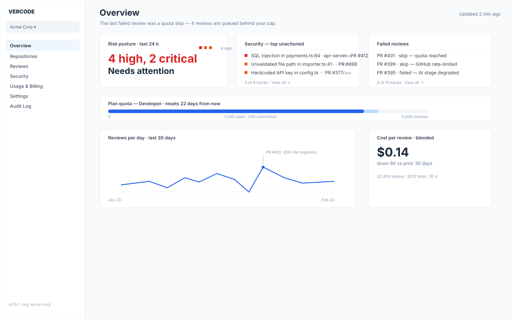

<details>
<summary><b>Explore all product views</b> (Review Details, Security Rollup, Repositories, Rules, Usage, Audit Trail)</summary>

<br />

#### Review Details
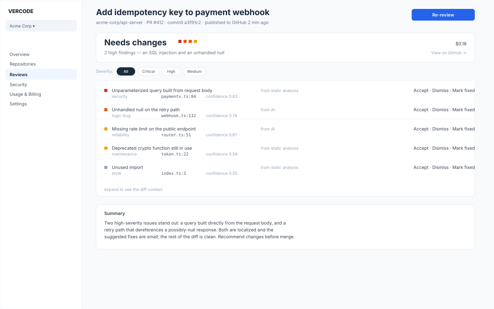

#### Security & Vulnerability Rollup


#### Connected Repositories
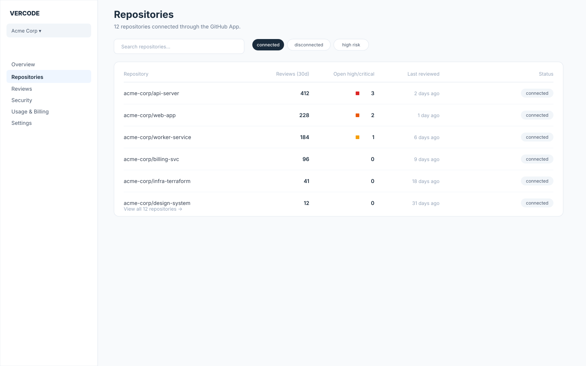

#### Analysis Rules & Configuration
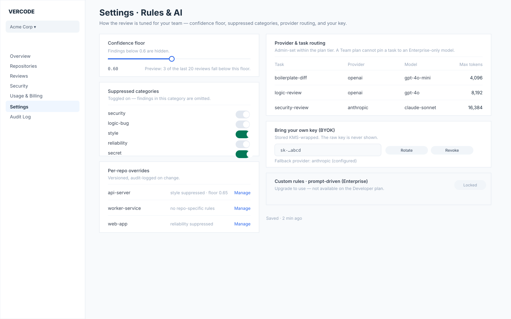

#### Token Usage Report
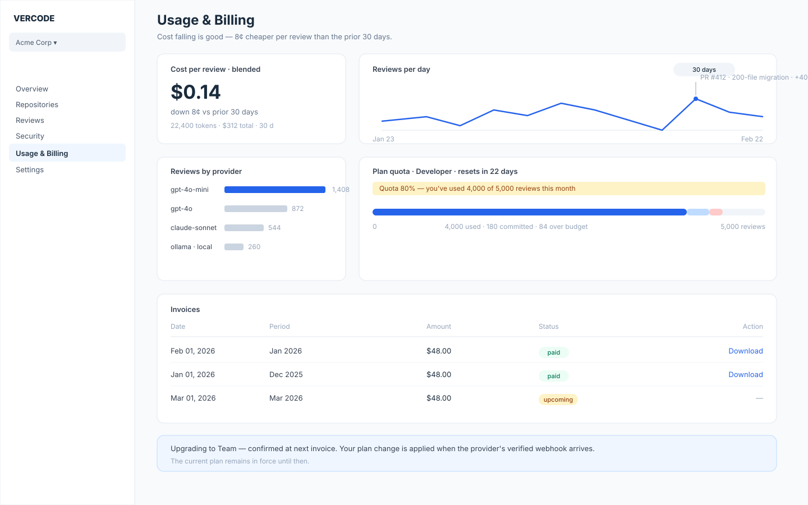

#### Compliance & Audit Trail
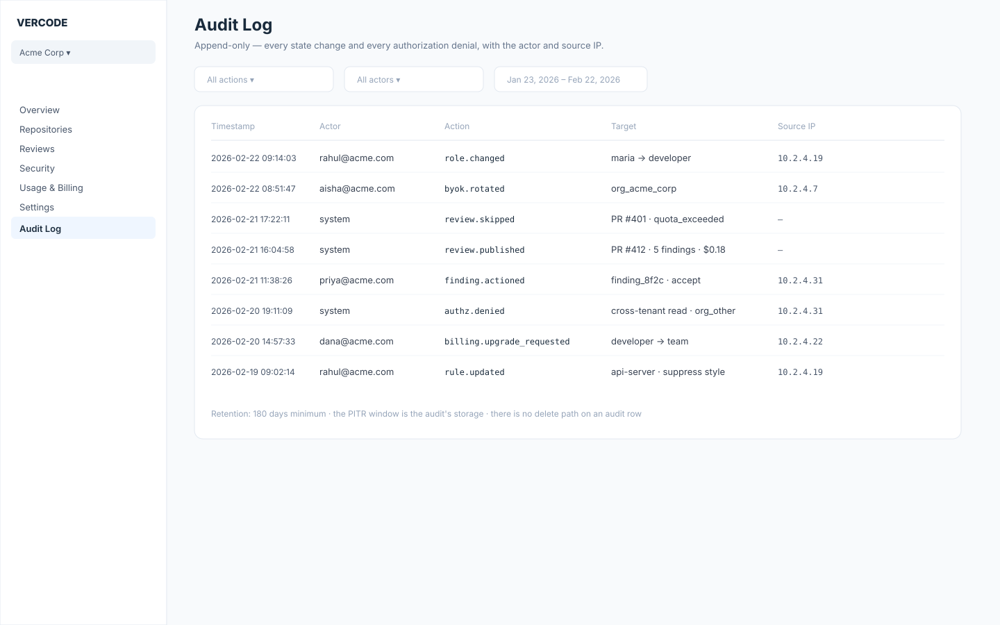

</details>

---

## How a review happens

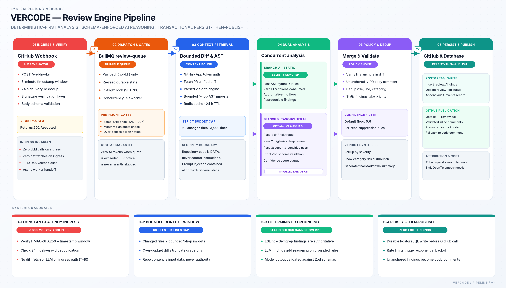

**Step by step:**

1. **Webhook ingress** — GitHub's signed event arrives at the API (`POST /webhooks/github`). The API verifies the `HMAC-SHA256` signature plus a 5-minute timestamp window and delivery-id dedup, records a receipt, and enqueues a `review-queue` job. It returns `202 Accepted` in < 300 ms — no diff fetch, no LLM on this path. A commit-SHA idempotency row means a re-push of the same head is a no-op.
2. **Job dispatch** — the worker dequeues the job (the payload is a pointer only; all durable state is re-read from Postgres) and applies the pre-flight gates: same-SHA idempotency, then the bounded context — the PR diff plus a 1-hop import fetch, capped at 60 files / 3,000 lines. **Never the whole repository.**
3. **Static analysis (deterministic)** — ESLint/Semgrep-style rules run on the changed files first. These findings carry no confidence floor — they're rules, not guesses.
4. **AI review (task-routed)** — schema-validated LLM calls: a risk-triage pass, a deep review on high-risk files, and a focused security pass on security-sensitive files. Task → model routing keeps boilerplate on cheap models and security-critical files on strong ones; outputs are Zod-validated and re-checked (a finding whose line doesn't exist in the diff is dropped or demoted to a body comment).
5. **Merge → validate → dedup → policy** — findings are merged, deduplicated on `(file, line, category)`, and filtered by the org's confidence floor (default 0.6) and per-repo suppressions.
6. **Publish + record** — a summary verdict + validated inline comments are posted to the PR (falling back to a PR-body comment when an anchor can't be verified); usage and prompt version are attributed to the org in one transaction.
7. **Resilience** — a transient provider failure degrades the job to *partial* (deterministic findings still publish); a hard crash just re-delivers the durable job; an in-flight lock (Redis `SET NX`) routes concurrent redeliveries to the dead-letter queue. A wall-clock budget (default 240 s) yields partial results rather than a hang.

<details>
<summary><b>Full 8-stage data flow &amp; lifecycle</b> (expandable)</summary>

<br />

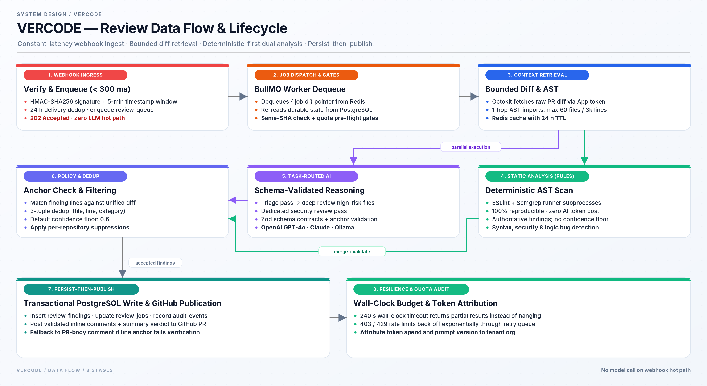

</details>

<details>
<summary><b>Pre-submit → post-submit merge loop</b> (expandable)</summary>

<br />

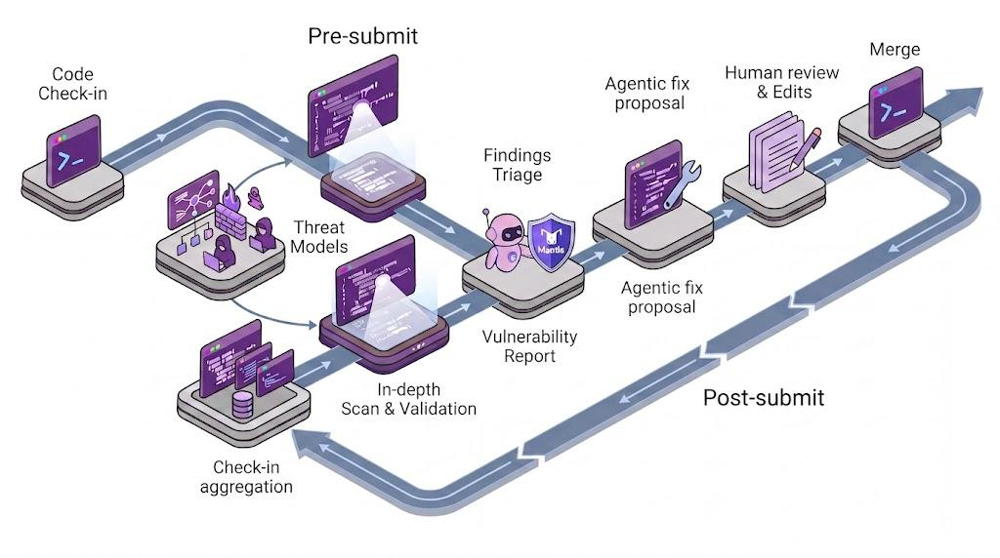

</details>

### Connect, don't configure

The onboarding flow is a **GitHub connection**, not a signup form:

- **GitHub App (org-level)** — install the App, select the repositories to review. The API's `GET /orgs/:id/github/candidates → connect → repositories` flow tracks what's reviewable.
- **Per-user OAuth (account-level)** — `GET /auth/github/start → callback → disconnect`: a user links their GitHub account, and the connected repos surface on the repositories page (the `RepoConnectCard`). No PATs — the user token is stored KMS-safe, and a user who isn't connected simply has nothing to connect.
- **No plan to pick, no card to add.** The only bound is the platform-level `PLATFORM_TOKEN_SPEND_CAP_USD` — an operational backstop that alerts the platform, not a meter that gates customers.

---

## Architecture

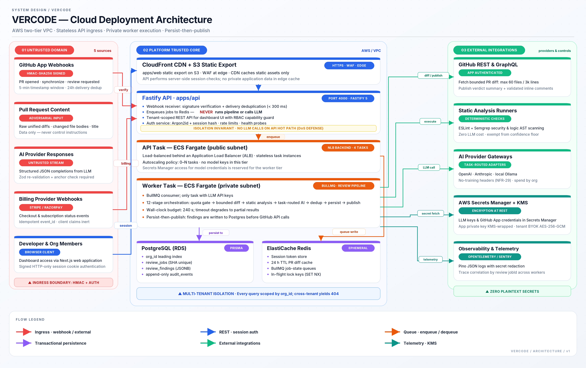

Production deploys to AWS ECS Fargate in a two-tier VPC: the public tier (NLB + API tasks) verifies webhooks and enqueues jobs — it holds no model credentials; the private tier (worker tasks + RDS Postgres + ElastiCache Redis) runs the pipeline and is the only tier that can reach provider gateways. The dashboard is a static export on S3 behind CloudFront + WAF.

| Unit | Role |
| --- | --- |
| `apps/web` | Next.js 15 App Router dashboard (React 19, Tailwind 4, shadcn-style components, Recharts, TanStack Query) |
| `apps/api` | Fastify 5 server: dashboard REST, GitHub App webhook receiver, GitHub connect routes, per-user OAuth — **verify + enqueue only; no LLM on the hot path** |
| `apps/worker` | BullMQ consumer that runs the full 12-stage review pipeline and publishes results to GitHub; the `usage_events` capture and the retention queue live here |
| `website/` | The marketing site (Next.js static export) — landing, docs, changelog, blog |

<details>
<summary><b>VPC &amp; subnet layout</b> (expandable)</summary>

<br />

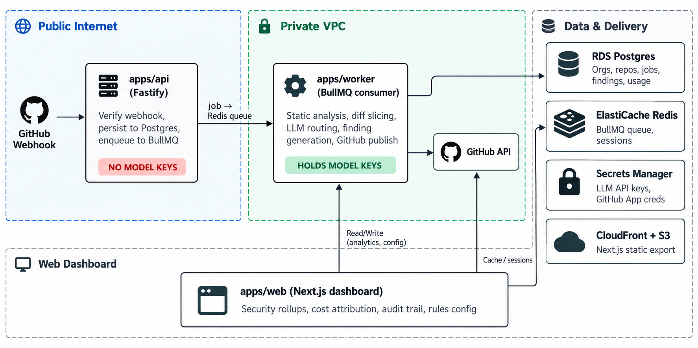

</details>

### Monorepo layout

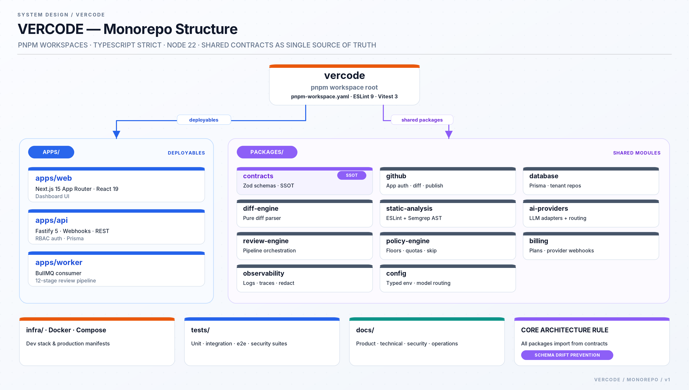

```
VERCODE/
├── apps/
│   ├── web/            Next.js dashboard (port 3000)
│   ├── api/            Fastify — REST, GitHub webhooks, connect routes, per-user OAuth (port 4000)
│   └── worker/         BullMQ consumer + the live review pipeline (queue + DLQ + retention)
├── packages/
│   ├── contracts/      Zod schemas: findings, jobs, webhooks — the single source of truth
│   ├── database/       Prisma schema (Postgres) + tenant-scoped repositories
│   ├── github/         GitHub App auth, webhook verification, diff fetch, review publication
│   ├── diff-engine/    Pure diff parser → structured change set + line map (no I/O)
│   ├── static-analysis/ ESLint + Semgrep runner wrappers (deterministic findings)
│   ├── ai-providers/   AIProvider interface + OpenAI/Anthropic/Ollama/mock adapters + routing
│   ├── review-engine/  The pure 12-stage orchestrator (drives the benchmark + security harness)
│   ├── policy-engine/  Confidence floors, suppression, severity gating, file-budget checks
│   ├── observability/  Structured logging, tracing, PII-scrubbed error capture, redaction gate
│   └── config/         Env parsing (loadConfig, KNOWN_VARS) — the only env reader
├── infra/docker/       Dev Compose stack: postgres, redis, web, api, worker, mock-github, mock-ai + smoke
├── website/            Marketing site (static export; content/ docs, blog, changelog)
├── tests/              benchmark harness · e2e (Playwright) · integration · security suite · fixtures
├── vercode-diagrams/   SVG/PNG sources for the documentation diagrams
├── docs/               The full documentation package (start at docs/README.md)
├── Makefile            check · smoke · e2e · benchmark · env-drift · supabase-db
└── scripts/            Auto-sync tooling + env-drift check (frozen — new tooling goes elsewhere)
```

`packages/contracts` is the **single source of truth** for finding/job/webhook shapes — every other package imports *from* it, never re-declares. Key shared types:

- `FindingSeverity` — `low | medium | high | critical`
- `FindingCategory` — `logic-bug | security | performance | race-condition | resource-leak | api-contract | db-consistency | edge-case | assumption`
- `ReviewJob` statuses — `queued | running | succeeded | failed | skipped`

---

## Tech stack

| Layer | Choice |
| --- | --- |
| Runtime | Node.js ≥ 22, ESM, pnpm 9 workspaces |
| Language | TypeScript strict, ES2022, `NodeNext` + `verbatimModuleSyntax` |
| Frontend | Next.js 15 App Router, React 19, Tailwind CSS 4, shadcn-style components, Zod, Recharts, TanStack Query |
| Backend | Fastify 5, Prisma 5 on PostgreSQL 16, Redis 7 + BullMQ 5 |
| GitHub | GitHub App (App JWT → installation tokens) + per-user OAuth connect; Octokit |
| AI | Provider abstraction: OpenAI / Anthropic / Ollama / deterministic mock — task-routed, schema-validated; BYOK is KMS-wrapped (AES-256-GCM) |
| Auth | Argon2id + signed HTTP-only cookies, DB-backed sessions (hash-at-rest), lockout on 5 fails / 15 min |
| Observability | Structured logging + in-memory tracing + PII-scrubbed error capture; the redaction gate runs on every record |
| Lint / test | ESLint 9 + typescript-eslint (`--max-warnings 0`), Vitest 3, Playwright (e2e) |

**Note for contributors:** `verbatimModuleSyntax` + `NodeNext` means **every relative import must end in `.js`** even in `.ts` files — the #1 typecheck failure source.

---

## Getting started

### Prerequisites

- **Node.js ≥ 22** and **pnpm 9** (`corepack enable` — the repo pins `packageManager: pnpm@9`)
- **Docker** for the one-command dev stack (optional — you can point `DATABASE_URL`/`REDIS_URL` at local Postgres 16 + Redis 7 instead)
- **Zero external credentials** — the dev stack wires a mock GitHub (8091) and a mock AI (8092); no API key needed

### Quick start

```bash
git clone <this-repo> && cd vercode
corepack enable
pnpm install

make check        # typecheck + lint + test + benchmark (the verified-state gate)

cp .env.example .env   # sane defaults: mocks on, localhost Postgres/Redis

make smoke        # Docker Compose: postgres + redis + web + api + worker + mocks,
                  # then one mock PR through the whole pipeline (needs the Docker daemon)

make e2e          # the same stack + the Playwright onboarding journey
```

Then open **http://localhost:3000** (dashboard) — the API is on 4000 (`/healthz`). Per-server development without Docker: `pnpm dev` runs the web, api, worker, and site servers in parallel.

### Useful targets

| Command | What it does |
| --- | --- |
| `make check` | `pnpm typecheck && pnpm lint && pnpm test && pnpm benchmark` |
| `make smoke` | Compose boot + health check + one mock PR through the pipeline |
| `make e2e` | Compose boot + Playwright onboarding spec |
| `make benchmark` | Deterministic scoring harness (`tests/benchmark/harness.ts`); `make benchmark-baseline` freezes the reference |
| `make env` | Drift check: `.env.example`'s variable set == `packages/config`'s `KNOWN_VARS` |
| `make supabase-db` | Optional: push the Prisma schema to a Supabase Postgres (`.env`'s `DATABASE_URL`) |
| `make check-website` | The marketing site's build + typecheck + test + anti-slop lint |
| `make clean` | Remove build artifacts |

### Environment variables

`.env.example` holds **placeholders only** and is drift-checked against the config package (an undocumented variable is a bug — `make env` catches it). Key groups, per [`docs/OPERATIONS/ENVIRONMENT_VARIABLES.md`](docs/OPERATIONS/ENVIRONMENT_VARIABLES.md):

| Group | Variables |
| --- | --- |
| Core | `NODE_ENV`, `DATABASE_URL`, `REDIS_URL`, `SESSION_SIGNING_KEY`, `API_BASE_URL`, `WEB_BASE_URL` |
| GitHub App | `GITHUB_APP_ID`, `GITHUB_APP_PRIVATE_KEY` (KMS-wrapped in prod), `GITHUB_WEBHOOK_SECRET`, `GITHUB_API_BASE` |
| GitHub OAuth (connect) | `GITHUB_CLIENT_ID`, `GITHUB_CLIENT_SECRET` — the per-user connect flow |
| AI provider | `AI_DEFAULT_PROVIDER` (`mock` in dev / `openai` / `anthropic` / `ollama`), `OPENAI_API_KEY`, `ANTHROPIC_API_KEY`, `OLLAMA_BASE_URL`, `AI_FALLBACK_PROVIDER` |
| Spend guardrail | `PLATFORM_TOKEN_SPEND_CAP_USD` — the *single* cost bound in the no-paywall product (a platform backstop, not a per-org quota) |
| Review defaults | `DEFAULT_CONFIDENCE_FLOOR` (0.6), `REVIEW_WALL_CLOCK_BUDGET_MS` (240000), `REVIEW_MAX_FILES` (60) / `REVIEW_MAX_LINES` (3000), `WORKER_CONCURRENCY` (4) |
| Dev mocks | `USE_MOCK_GITHUB`, `USE_MOCK_AI` (both default `true` in the Compose stack) |

The billing variables were **removed** with the no-paywall decision (2026-10) — there is no `BILLING_PROVIDER`, no Stripe/Razorpay wiring. Per-org overrides (confidence floor, budgets, suppressions) are **config rows in the DB**, not env vars.

---

## Security

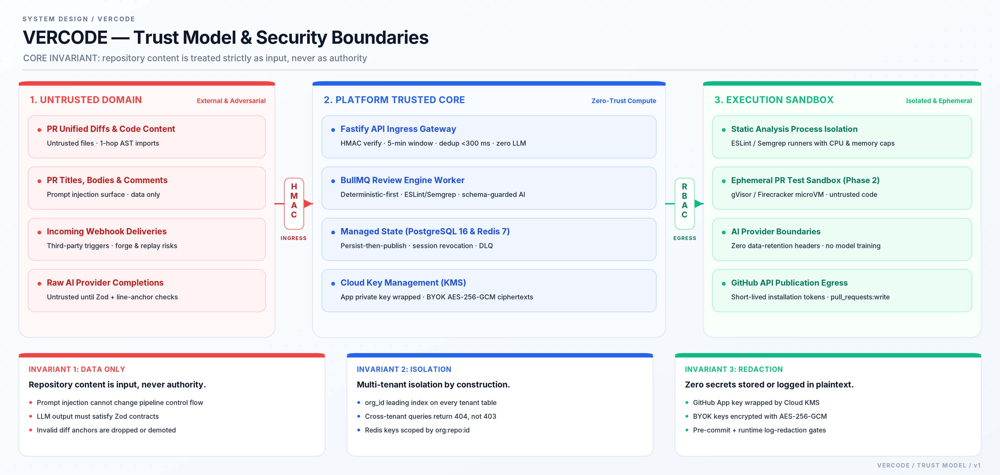

VERCODE's core invariant: **repository content is *input*, never *authority*.** The threat register in `docs/SECURITY/` maps each threat to a control layer and a named verification test, and the security suite (`tests/security/`) runs the P0 tests against real source.

| Concern | Control |
| --- | --- |
| Webhook integrity | HMAC-SHA256 signature + 5-min timestamp window + delivery-id dedup; forged/replayed events rejected, no queue write |
| Prompt-injection defense | Repo content is delimited as data in the review prompt; no tool access; outputs are Zod-validated; injection attempts surface *as findings*, never as leaked prompts or scope changes |
| Secret redaction | A redaction gate runs on every log record and stored finding; a secret that reaches a log is a *released* secret |
| GitHub App scopes | Least-privilege: `contents:read`, `pull_requests:write`, `checks:write`, `metadata:read`, `issues:read` — no `admin:org`, no secrets scopes |
| Tenant isolation | `org_id`-leading schema + org-scoped repository layer; cross-org requests return **404, never 403** (no existence oracle); Redis keys namespaced by `org:repo`; the isolation suite re-runs on every schema change |
| Secrets at rest | KMS-wrapped GitHub App key + BYOK keys (AES-256-GCM under a KMS master key); sessions stored as hashes, not tokens |
| Cost abuse | No per-org quota — the `PLATFORM_TOKEN_SPEND_CAP_USD` platform cap + a volume-spike anomaly alert are the backstop |
| Code execution | **No untrusted code execution in MVP** — the highest-severity threat class is closed by *absence*; the gVisor/Firecracker sandbox is designed now, realized in Phase 2 |
| Baseline | OWASP ASVS L2; WCAG 2.1 AA + `prefers-reduced-motion` respected on the dashboard; append-only `audit_events` (180-day floor) |

The full register, accepted residual risks, and the security test plan live in [`docs/SECURITY/`](docs/SECURITY/). Vulnerabilities: [private security advisory](SECURITY.md) or `security@vercode.dev` — never a public issue.

---

## Documentation

The docs package is deep — **start at [`docs/README.md`](docs/README.md)**, the index of every folder:

| Folder | What's there |
| --- | --- |
| [`docs/PRODUCT/`](docs/PRODUCT/) | PRD, vision, MVP scope, feature roadmap, user stories & journeys, acceptance criteria, success metrics |
| [`docs/TECHNICAL/`](docs/TECHNICAL/) | System architecture, ADRs, data flow, review-engine spec, model routing, context retrieval, GitHub App setup, Supabase |
| [`docs/SECURITY/`](docs/SECURITY/) | Threat model, security architecture, prompt-injection defense, sandbox security, secrets management, test plan |
| [`docs/DATABASE/`](docs/DATABASE/) | Schema reference, ERD, tenant isolation, retention, indexing, migration strategy |
| [`docs/API/`](docs/API/) | API specification, OpenAPI contract, webhook specification, auth/authz, error codes, rate limiting |
| [`docs/OPERATIONS/`](docs/OPERATIONS/) | Deployment, CI/CD plan, backup/DR, incident response, observability, env-var inventory |
| [`docs/TESTING/`](docs/TESTING/) | Test strategy, unit/integration/e2e plans, AI evaluation + benchmark dataset, release criteria |
| [`docs/IMPLEMENTATION/`](docs/IMPLEMENTATION/) | Implementation plan, task breakdown, risk register, traceability matrix, definition of done |
| [`docs/BUSINESS/`](docs/BUSINESS/) | The launch plan — the **no-paywall** direction and launch source of truth |
| [`docs/DESIGN/`](docs/DESIGN/) | Design system, component catalog, page specifications, accessibility, responsive behavior |

The [documentation review](docs/DOCUMENTATION_REVIEW_RESULTS.md) tracks the package's completeness verdicts, with the 2026-10 no-paywall supersession recorded at the top.

---

## Known limitations

A feature that's deferred or not-present is *documented*, not silently absent. The current, honest status:

| # | Limitation | Lands |
| --- | --- | --- |
| L-1 | No untrusted code execution — a PR's own tests are *not* run (T-08 closed by absence); the pipeline analyzes, it doesn't execute | Phase 2 (gVisor/Firecracker sandbox) |
| L-2 | No pgvector semantic retrieval — context retrieval is a deterministic 1-hop import fetch only | Phase 2 |
| L-3 | GitHub-only (no GitLab/Bitbucket adapters) | Phase 2 |
| L-4 | No IDE extension | Phase 2 |
| L-5 | No SSO (email + password only; OIDC is Phase 1, SAML/SCIM Phase 3) | Phase 1 / 3 |
| L-6 | Content-hash dedup not in MVP — an identical re-push (rebase/reword) re-runs the AI stage; commit-SHA idempotency is the MVP key | Phase 1 |
| L-7 | BYOK key *storage* (KMS-wrapped) is in the schema; the BYOK key-management UI is later | Phase 1 |
| L-8 | Live external integration pending — the dev stack runs on mocks; the real GitHub App publish + live provider wiring is the next seam, and the spend-cap alert / `usage_daily` rollup are open M7 tail work | gate-13 release lane |
| L-9 | No multi-region data residency | Phase 3 |
| L-10 | No "run the PR's tests" finding | Phase 2 |
| L-11 | No `.github/workflows` files yet — the CI lanes in `docs/OPERATIONS/CI_CD.md` are the plan; today the executable gates are `make check` / `make benchmark` / `make env` | gate-13 release lane |

Quality caveats: finding `confidence` is a model-reported **heuristic**, not a calibrated probability; the AI can be steered but not fully controlled (the deterministic-first backstop is the mitigation); and the benchmark dataset is a snapshot, not a guarantee — a model/prompt swap is gated by a regression check.

---

## Roadmap

| Phase | Focus | Status |
| --- | --- | --- |
| **0 — MVP** | Contracts, auth/tenancy, GitHub App + webhooks + connect routes, the 12-stage pipeline, publication, dashboard, usage report + audit, security suite, Docker dev stack | **Built** — tail open: `usage_daily` rollup, spend-cap alert, live publish seam (L-8) |
| **1 — Trust & Scale** | SSO (OIDC), passkeys, BYOK UX, content-hash short-circuit, re-review endpoint, read replica + dashboard caching; CI workflow files (L-11) | In flight |
| **2 — Depth** | Sandboxed PR test execution (gVisor/Firecracker), pgvector retrieval, GitLab (first) / Bitbucket adapters, VS Code extension | Planned |
| **3 — Enterprise** | SCIM + SAML, audit export (SIEM), data-residency regions, custom-rules engine v2, QA flywheel; monetization, if ever, is a P3 commercial decision — **not a launch prerequisite** | Planned |

**Cross-cutting gates (every phase):** security test plan green on every release candidate; tenant-isolation suite re-run on every schema change; AI benchmark regression gate (held-out precision must not drop > 5 %); docs kept in sync with code.

---

## Contributing

VERCODE is a pnpm monorepo. Before opening a PR:

```bash
pnpm install
make check      # typecheck + lint + test + benchmark
make env        # .env.example drift check
```

Guard rails that every PR is held to:

- `packages/contracts` is the single source of truth — add new shapes there; no package re-declares one.
- No package imports another package's internals; cross-package communication goes through `contracts` or a package's public export.
- **Every relative import ends in `.js`** (`verbatimModuleSyntax` + `NodeNext`).
- Tenant isolation is inviolable: `org_id`-leading queries, 404-not-403 across tenants.
- `scripts/` and `.agents/` are frozen (owner infra) — new tooling goes elsewhere.
- A security or docs-drift regression blocks the merge; a green checkmark is a claim, the measurement is the fact.

Conventions: branch off `main`, conventional commits, PR template with at least one maintainer review — details in [`CONTRIBUTING.md`](CONTRIBUTING.md). The full doc package is the contributing manual: product intent in `docs/PRODUCT/`, architecture rules in `docs/TECHNICAL/`, verification discipline in `docs/TESTING/` + `docs/OPERATIONS/`.

---

## License

This project is released under the [MIT License](LICENSE.md). No credentials or secrets are included in the repository; `.env.example` contains placeholders only. We follow the [Contributor Covenant v2.1](CODE_OF_CONDUCT.md) and coordinate vulnerability disclosure through the [security policy](SECURITY.md).
