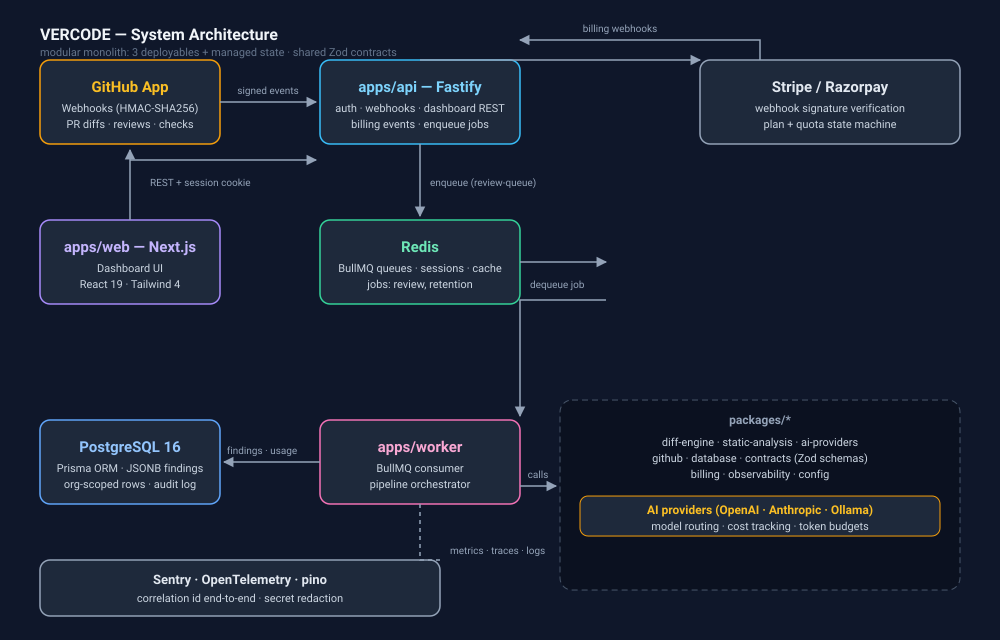
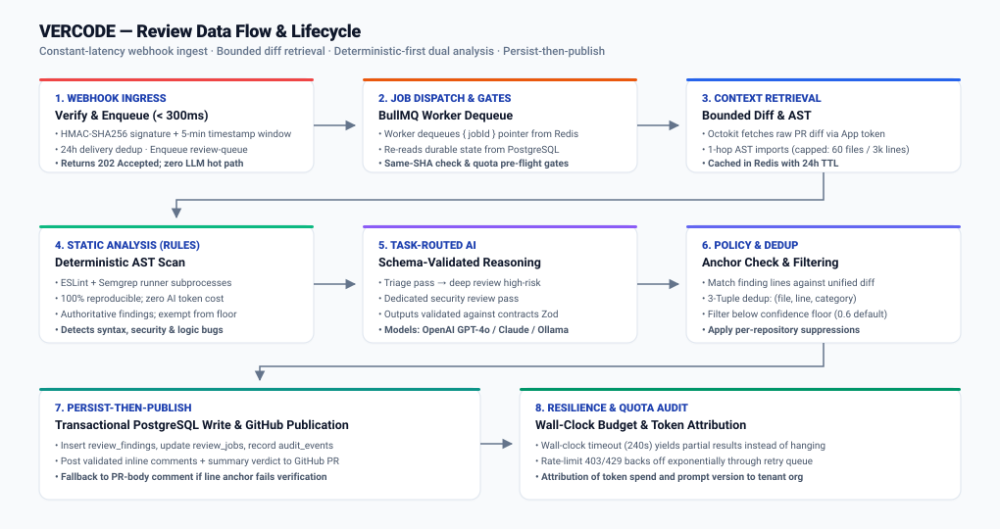
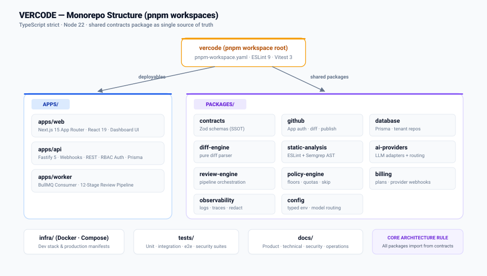

<div align="center">

# VERCODE

**AI-powered code review for GitHub pull requests — deterministic-first analysis, evidence-backed findings, and a first-class team dashboard.**

[](https://nodejs.org/)
[](https://pnpm.io/)
[](https://www.typescriptlang.org/)
[](LICENSE.md)

</div>

---

## What is VERCODE?

VERCODE is an open-source AI code-review SaaS monorepo. It reads a GitHub pull request the way a careful senior engineer would: deterministic static analysis (ESLint + Semgrep + secret scanning) runs **first**, then task-routed LLM reasoning runs on the bounded, relevant slice of the diff. The result is published back to the PR as **inline findings** — each with a category, severity, confidence score, a reason, and a suggested fix — plus a **summary verdict**, backed by a multi-tenant org dashboard.

**Target:** GitHub-using teams of 3–500 developers who want a second pair of AI eyes that doesn't flood the PR with noise.

| Pillar | What it means |
| --- | --- |
| **Deterministic precision** | Static analysis runs before the LLM. The model's findings are deltas on top of grounded, reproducible checks. |
| **Evidence-backed reasoning** | Every finding carries a category, severity, confidence, a short reason, and a suggested fix — published as GitHub inline comments a maintainer can act on. |
| **Cost discipline** | Tiered model routing, per-org token budgets, and explicit per-review cost tracking. |
| **A workspace, not just a bot** | The dashboard is a first-class product surface: review history, security rollups, usage + billing, audit trail. |

> **Current state:** this repository is at the *scaffold + design* stage. The docs, shared contracts, and workspace layout are in place; the application code is being built phase by phase (see [Roadmap](#roadmap)). The [Known Limitations](#known-limitations) section is the honest, up-to-date status.

---

## Repository overview

### Architecture



Three stateless, independently deployable units sit in front of managed Postgres and Redis:

| Unit | Role |
| --- | --- |
| `apps/web` | Next.js App Router dashboard (Tailwind, shadcn-style components, Recharts) |
| `apps/api` | Fastify HTTP server: dashboard REST, GitHub App webhook receiver, billing webhooks — **verify + enqueue only; no LLM on the hot path** |
| `apps/worker` | BullMQ consumer that runs the full review pipeline and publishes results to GitHub |

### Review pipeline



**How it works, step by step:**

1. **Webhook ingress** — GitHub's signed event arrives at the API. The API verifies the `HMAC-SHA256` signature plus a 5-minute timestamp window and 24 h delivery-id dedup, records an idempotency row, and enqueues a `review-queue` job. It returns `202 Accepted` in < 300 ms — no diff fetch, no LLM, no finding writes on this path.
2. **Job dispatch** — the worker dequeues the job (payload is a pointer only; all durable state is re-read from Postgres), loads the org's plan, quotas, and settings, and applies pre-flight gates: commit-SHA idempotency (same head SHA → no re-run), quota check (over-cap → `skipped` with a notice posted, **never silent**, and zero AI tokens consumed).
3. **Context retrieval** — the worker fetches the PR diff plus a bounded context: changed files + their 1-hop import graph, capped at 60 files / 3,000 lines. **Never the whole repository.**
4. **Static analysis (deterministic)** — ESLint/Semgrep-style rules run on the changed files first. These findings carry no confidence floor — they're rules, not guesses.
5. **AI review (task-routed)** — schema-validated LLM calls: a risk-triage pass, a deep review on high-risk files, and a focused security pass on security-sensitive files. Bounded context only; outputs are Zod-validated and re-checked (a finding whose line doesn't exist in the diff is dropped or demoted to a body comment).
6. **Merge → validate → dedup → policy** — findings are merged, deduplicated on `(file, line, category)`, and filtered by the org's confidence floor (default 0.6) and per-repo suppressions.
7. **Publish** — a summary verdict + validated inline comments are posted to the PR (falling back to a PR-body comment when an anchor can't be verified); usage, cost, and prompt version are attributed to the org.
8. **Resilience** — rate-limit responses (403/429) back off through a retry queue; a hard crash just re-delivers the durable job. A wall-clock budget (default 240 s) yields *partial* results rather than a hang.

### Monorepo layout



```
VERCODE/
├── apps/
│   ├── web/            Next.js dashboard
│   ├── api/            Fastify — auth, REST, GitHub + billing webhooks
│   └── worker/         BullMQ consumer + review pipeline
├── packages/
│   ├── contracts/      Zod schemas: findings, jobs, plans, webhooks (single source of truth)
│   ├── database/       Prisma schema + generated client + tenant-scoped repositories
│   ├── github/         GitHub App auth, webhook verification, diff fetch, review publication
│   ├── diff-engine/    Pure diff parser → structured change set + line map (no I/O)
│   ├── static-analysis/ ESLint + Semgrep runner wrappers (deterministic findings)
│   ├── ai-providers/   AIProvider interface + OpenAI/Anthropic/Ollama adapters + routing + cost
│   ├── review-engine/  Orchestration: classify → static → AI → merge → validate → dedup → policy → summary
│   ├── policy-engine/  Confidence floors, suppression, severity gating, quota + file-budget checks
│   ├── billing/        Plan state machine + provider webhooks (Stripe / Razorpay)
│   ├── observability/  Logging, tracing, redaction, error capture
│   └── config/         Env parsing + typed config, model routing table, provider rate table
├── infra/              Docker / compose / deployment manifests
├── tests/              fixtures · integration · e2e · security suites
├── docs/               The full documentation package (start here: docs/DOCUMENTATION_REVIEW.md)
├── scripts/            Auto-sync tooling (frozen — new tooling goes elsewhere)
└── .agents/            Installed design skills (frozen)
```

The `packages/contracts` package is the **single source of truth** for finding/job/plan/webhook shapes — every other package imports *from* it, never re-declares.

Key shared types already in `packages/contracts`:

- `FindingSeverity` — `low | medium | high | critical`
- `FindingCategory` — `logic-bug | security | performance | race-condition | resource-leak | api-contract | db-consistency | edge-case | assumption`
- `ReviewJob` statuses — `queued | running | succeeded | failed | skipped`
- Plan quotas — FREE / DEVELOPER / TEAM / ENTERPRISE (in the referenced `plans` module; this is the first gap being closed in Phase 0)

---

## Tech stack

| Layer | Choice |
| --- | --- |
| Runtime | Node.js ≥ 22, ESM, pnpm 9 workspaces (lockfile v9) |
| Language | TypeScript 5.x strict, ES2022, `NodeNext` + `verbatimModuleSyntax` |
| Frontend | Next.js 15 App Router (`output: standalone`), React 19, Tailwind CSS 4, shadcn-style components, Zod, Recharts, TanStack Query |
| Backend | Fastify 5, Prisma 5, PostgreSQL 16, Redis 7 + BullMQ 5 |
| GitHub | Octokit, GitHub App strategy (App JWT → installation tokens) |
| AI | OpenAI primary; provider abstraction supports Anthropic / Ollama (Phase 1) and BYOK (AES-256-GCM, KMS-wrapped) |
| Billing | Stripe (default) / Razorpay adapter for the INR market |
| Auth | Argon2id + signed HTTP-only cookies, Redis-backed sessions, server-side revocation |
| Observability | pino + OpenTelemetry + Sentry; secret redaction on every log record |
| Lint / test | ESLint 9 + typescript-eslint (`--max-warnings 0`), Vitest 3 |

**Note for contributors:** `verbatimModuleSyntax` + `NodeNext` means **every relative import must end in `.js`** even in `.ts` files. This is the #1 typecheck failure source — CI catches it.

---

## Getting started

### Prerequisites

- **Node.js ≥ 22** and **pnpm 9** (`corepack enable` works: the repo pins `packageManager: pnpm@9`)
- **PostgreSQL 16** and **Redis 7** locally (or via the Compose dev stack — planned in `infra/docker/`)
- No external credentials are required for local development: the provider layer supports an offline/mock AI adapter, and the dev stack wires mock GitHub + mock billing

### Install

```bash
git clone <this-repo>
cd vercode
pnpm install
```

### Build & test

```bash
pnpm install        # pnpm 9, Node >= 22
pnpm typecheck      # pnpm -r typecheck
pnpm lint           # eslint "packages/**/*.ts" "apps/**/*.ts" --max-warnings 0
pnpm test           # vitest run
pnpm test:watch     # vitest (watch mode)
pnpm build          # pnpm -r build
pnpm dev            # run all workspace dev servers
```

Development servers (once apps are wired): `web` on port 3000 (`next dev -p 3000`), `api` and `worker` via `tsx`. The target dev stack is a Docker Compose file (Postgres + Redis + web + api + worker + mock-github/mock-ai/mock-billing) so the full pipeline runs with **zero external credentials** — that compose file is part of the Phase 0 work, not yet committed.

### Environment variables

Real credentials live in a secret store; `.env.example` (coming with Phase 0) holds **placeholders only**. Key groups, per `docs/OPERATIONS/ENVIRONMENT_VARIABLES.md`:

| Group | Variables |
| --- | --- |
| Core | `NODE_ENV`, `DATABASE_URL`, `REDIS_URL`, `SESSION_SIGNING_KEY`, `API_BASE_URL`, `WEB_BASE_URL` |
| GitHub App | `GITHUB_APP_ID`, `GITHUB_APP_PRIVATE_KEY` (KMS-wrapped), `GITHUB_WEBHOOK_SECRET`, `GITHUB_API_BASE` |
| AI provider | `AI_DEFAULT_PROVIDER` (`openai`/`anthropic`/`ollama`/`mock`), `OPENAI_API_KEY`, `ANTHROPIC_API_KEY`, `OLLAMA_BASE_URL`, `AI_FALLBACK_PROVIDER` |
| Billing | `BILLING_PROVIDER` (`stripe`/`razorpay`), `STRIPE_SECRET_KEY`, `STRIPE_WEBHOOK_SECRET`, `RAZORPAY_KEY_ID`/`RAZORPAY_KEY_SECRET`, `BILLING_CURRENCY` |
| Observability | `SENTRY_DSN_API`/`_WORKER`/`_WEB`, `OTEL_EXPORTER_OTLP_ENDPOINT`, `LOG_LEVEL` |
| Quota defaults | `PLATFORM_TOKEN_SPEND_CAP_USD`, `DEFAULT_CONFIDENCE_FLOOR` (0.6), `REVIEW_WALL_CLOCK_BUDGET_MS` (240000), `REVIEW_MAX_FILES` (60) / `REVIEW_MAX_LINES` (3000), `WORKER_CONCURRENCY` (4) |
| Dev mocks | `USE_MOCK_GITHUB`, `USE_MOCK_AI`, `USE_MOCK_BILLING` |

Per-org overrides (confidence floor, file budgets, suppressions) are **config rows in the DB**, not env vars — env holds platform defaults only.

---

## Security

VERCODE's core invariant: **repository content is *input*, never *authority*.** The design docs in `docs/SECURITY/` define a 16-threat STRIDE register (T-01…T-16), each mapped to a control layer and a named verification test.

| Concern | Control |
| --- | --- |
| Webhook integrity | HMAC-SHA256 signature + 5-min timestamp window + 24 h delivery-id dedup; forged/replayed events rejected, no queue write |
| Prompt-injection defense | Repo content is delimited as data in the review prompt; no tool access; outputs are schema-validated (Zod); injection attempts surface *as findings*, never as leaked prompts or scope changes |
| Secret redaction | A redaction gate runs on every log record and stored finding; a secret that reaches a log is a *released* secret |
| GitHub App scopes | Least-privilege: `contents:read`, `pull_requests:write`, `checks:write`, `metadata:read`, `issues:read` — no `admin:org`, no secrets scopes |
| Tenant isolation | `org_id`-leading schema + org-scoped repository layer; cross-org requests return **404, never 403** (no existence oracle); Redis keys namespaced by `org:repo`; an integration suite re-runs on every schema change |
| Secrets at rest | KMS-wrapped GitHub App key + BYOK keys (AES-256-GCM under a KMS master key); no secret in a DB column |
| Code execution | **No untrusted code execution in MVP** — the highest-severity threat class is closed by *absence*; the gVisor/Firecracker sandbox is designed now and realized in Phase 2 |
| Billing integrity | Plan state moves only on a **verified provider webhook**; client claims are inert; event-id idempotency |
| Baseline | OWASP ASVS L2; WCAG 2.1 AA + `prefers-reduced-motion` respected on the dashboard; append-only `audit_events` (180-day floor) |

The full register, accepted residual risks, and the security test plan live in [`docs/SECURITY/`](docs/SECURITY/).

---

## Documentation map

| Directory | Contents |
| --- | --- |
| [`docs/PRODUCT/`](docs/PRODUCT/) | PRD, MVP scope, feature roadmap, user stories & journeys, acceptance criteria, success metrics |
| [`docs/TECHNICAL/`](docs/TECHNICAL/) | System architecture, tech stack, repository structure, data flow, review-engine spec, AI system design, model routing, context retrieval, TRD, error handling |
| [`docs/SECURITY/`](docs/SECURITY/) | Threat model (T-01…T-16), security architecture, prompt-injection defense, sandbox security, secrets management, security test plan |
| [`docs/DATABASE/`](docs/DATABASE/) | Schema reference, ERD, tenant isolation, retention, indexing, migration strategy |
| [`docs/API/`](docs/API/) | API specification, OpenAPI contract, webhook specification, auth/authz, error codes, rate limiting |
| [`docs/OPERATIONS/`](docs/OPERATIONS/) | CI/CD, deployment, backup/restore, DR, incident response, observability, cost model, env-var inventory |
| [`docs/TESTING/`](docs/TESTING/) | Test strategy, unit/integration/E2E plans, AI evaluation + benchmark dataset, release criteria |
| [`docs/IMPLEMENTATION/`](docs/IMPLEMENTATION/) | Implementation plan, task breakdown, risk register, traceability matrix, definition of done, known limitations |
| [`docs/BUSINESS/`](docs/BUSINESS/) | Pricing strategy, usage quotas, billing specification, launch plan |
| [`docs/DESIGN/`](docs/DESIGN/) | Design system, component catalog, page specifications, accessibility, responsive behavior |

---

## Known limitations

A feature that's deferred or not-present is *documented*, not silently absent. The current, honest status:

| # | Limitation | Lands |
| --- | --- | --- |
| L-1 | No untrusted code execution — a PR's own tests are *not* run (T-08 closed by absence); the pipeline analyzes, it doesn't execute | Phase 2 (gVisor/Firecracker sandbox) |
| L-2 | No pgvector semantic retrieval — context retrieval is a deterministic 1-hop import fetch only | Phase 2 |
| L-3 | GitHub-only (no GitLab/Bitbucket adapters) | Phase 2 |
| L-4 | No IDE extension | Phase 2 |
| L-5 | No SSO (email + password only; OIDC is Phase 1, SAML/SCIM Phase 3) | Phase 1 / 3 |
| L-6 | Content-hash dedup not in MVP — an identical re-push (rebase/reword) re-runs the AI stage; commit-SHA idempotency is the MVP key | Phase 1 |
| L-7 | BYOK key *storage* (KMS-wrapped) is in the schema; the BYOK key-management UI is later | Phase 1 |
| L-8 | Live external integration (real GitHub App + live provider + live billing) is blocked in this build environment — the dev stack runs on mocks | gate-13 release lane |
| L-9 | No multi-region data residency | Phase 3 |
| L-10 | No "run the PR's tests" finding | Phase 2 |

Quality caveats: finding `confidence` is a model-reported **heuristic**, not a calibrated probability; the AI can be steered but not fully controlled (the deterministic-first backstop is the mitigation); and the benchmark dataset is a snapshot, not a guarantee — a model/prompt swap is gated by a regression check.

---

## Roadmap

| Phase | Focus | Measurable exit |
| --- | --- | --- |
| **0 — MVP (~12–16 wks)** | All P0: contracts + plans, auth/tenancy, GitHub App + webhooks, review pipeline, publication, queue/worker, dashboard, usage + billing stub + audit, security suite, Docker/CI | End-to-end checklist passes with at least one real PR review published; dashboard live on real data; security suite green |
| **1 — Trust & Scale (~8–12 wks)** | SSO (OIDC), passkeys, BYOK UX, multi-provider + provider fallback (FR-314), content-hash short-circuit, live Stripe capture (FR-509), re-review endpoint (US-105), read replica + dashboard caching | SSO live on one org; BYOK on one org; content-hash dedup cuts re-push cost ≥ 40 %; zero cross-tenant regressions |
| **2 — Depth (~12–16 wks)** | Sandboxed PR test execution (gVisor/Firecracker), pgvector retrieval, GitLab (first) / Bitbucket adapters, VS Code extension | Sandboxed test-execution on Team+ plans; ≥ 1 GitLab org live; IDE extension beta |
| **3 — Enterprise (ongoing)** | SCIM + SAML, audit export (SIEM), data-residency regions, custom-rules engine v2, QA flywheel, cost analytics | ≥ 3 enterprise logos; SCIM live; zero PII in logs audited clean |

**Cross-cutting gates (every phase):** security test plan green on every release candidate; tenant-isolation suite re-run on every schema change; AI benchmark regression gate (held-out precision must not drop > 5 %); docs kept in sync with code.

---

## Contributing

VERCODE is a pnpm monorepo. Before opening a PR:

```bash
pnpm install
pnpm typecheck   # pnpm -r typecheck — verbatimModuleSyntax: relative imports end in .js
pnpm lint        # eslint "packages/**/*.ts" "apps/**/*.ts" --max-warnings 0
pnpm test        # vitest run
```

Guides that every PR is held to (details in [`docs/IMPLEMENTATION/IMPLEMENTATION_PLAN.md`](docs/IMPLEMENTATION/IMPLEMENTATION_PLAN.md)):

- `packages/contracts` is the single source of truth — add new shapes there; no package re-declares one.
- No package imports another package's internals; cross-package communication goes through `contracts` or a package's public export.
- `scripts/` and `.agents/` are frozen (owner infra) — new tooling goes elsewhere.
- A security or docs-drift regression blocks the merge; a green checkmark is a claim, the measurement is the fact.

The full doc package is the contributing manual: product intent in `docs/PRODUCT/`, architecture rules in `docs/TECHNICAL/`, and the verification discipline in `docs/TESTING/` + `docs/OPERATIONS/`.

---

## License

This project is released under the [MIT License](LICENSE.md). No credentials or secrets are included in the repository; `.env.example` (Phase 0) will contain placeholders only.
