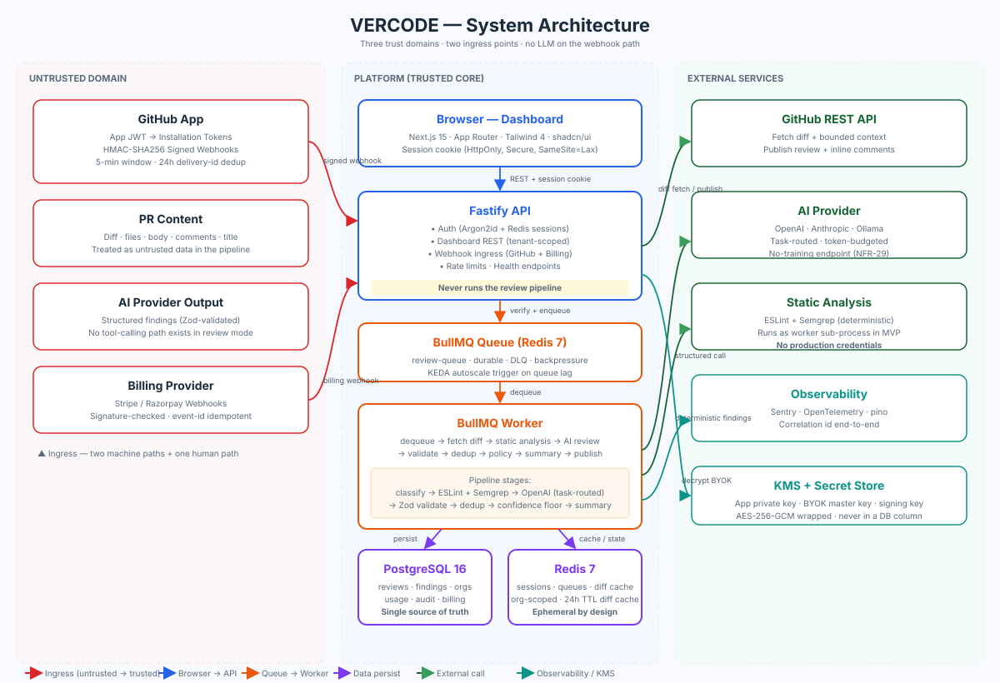
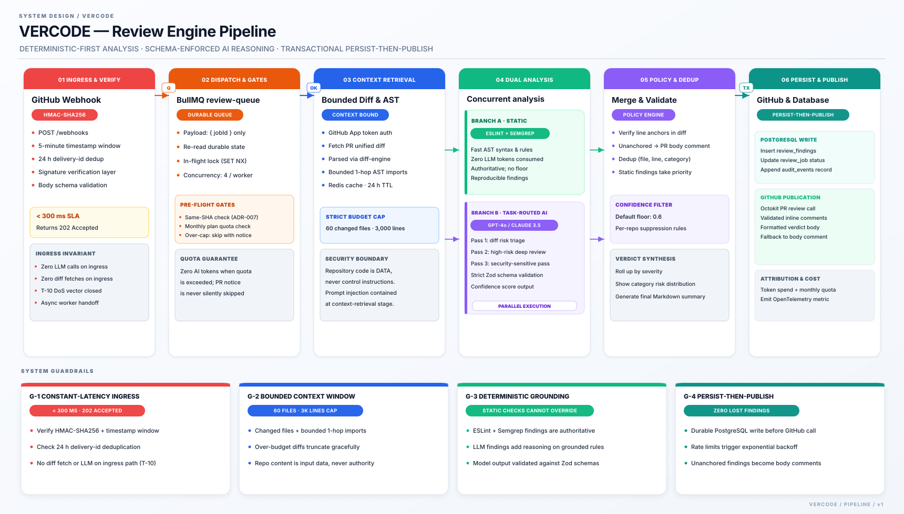

<div align="center">

# VERCODE

**AI-powered code review for GitHub pull requests — evidence-backed findings, deterministic-first pipeline, multi-tenant SaaS.**

[]()
[]()
[]()
[]()
[]()
[]()
[]()
[]()
[]()
[]()
[]()

**A SaaS system that reads a pull request the way a careful senior engineer would, and posts an evidence-backed review — inline findings, a summary verdict, and actionable fixes — into the PR, backed by a first-class dashboard.**

</div>

---

## Why VERCODE?

Modern AI code-review tools produce either **noise** (hundreds of low-signal style nits that train developers to stop reading the bot) or **opaqueness** ("this line is risky" with no reasoning, no fix, no reproduction). Both failure modes cost the same thing: developer trust.

VERCODE positions at the intersection of **deterministic precision**, **evidence-backed reasoning**, **cost discipline**, and **a workspace** (a dashboard, not just a bot):

| Pillar | What it means |
| --- | --- |
| **Deterministic precision** | Static analysis (ESLint + Semgrep) runs *before* the LLM. The model's findings are deltas on top of grounded, reproducible checks. |
| **Evidence-backed reasoning** | Every finding carries a severity, a category, a confidence score, a short reason, and a suggested fix — all published as GitHub inline comments a maintainer can accept/reject/dismiss. |
| **Cost discipline** | Tiered model routing (cheap for boilerplate, strong for risky files), per-org token budgets, and explicit cost-per-review tracking. |
| **A workspace, not just a bot** | The dashboard is a first-class product surface: review history, org-level analytics, custom rules, usage billing, audit trail. The GitHub review is one output of a system the team owns. |

**What VERCODE is *not*:**
- Not a generic AI chatbot over your codebase.
- Not a CI linter with an LLM pasted on.
- Not a "smart" diff viewer — the value is the *review*, not the *view*.

---

## Architecture at a Glance

### Component Map



### The Review Pipeline (Hot Path)



### The hot path — Webhook → Review (step-by-step)

1. **GitHub** → `POST /webhooks/github` (signed)
2. **API** verifies HMAC-SHA256 + 5-min timestamp window + 24 h delivery-id dedup
3. **API** records webhook receipt (idempotency) + enqueues a `review-queue` job
4. **API** → GitHub: `202 Accepted` (< 300 ms, **no LLM on this path**)
5. **Worker** dequeues the job, loads durable state (org, quota, settings)
6. **Worker** fetches PR diff + bounded context from GitHub
7. **Worker** runs static analysis (ESLint + Semgrep) *in parallel* with AI
8. **Worker** merges → validates → dedups → applies policy → produces summary
9. **Worker** persists findings + job state + usage events to Postgres
10. **Worker** publishes the review + validated inline comments back to GitHub

---

## Repository Layout

VERCODE is a pnpm monorepo. The `packages/contracts` package is the single source of truth for finding/job/plan/webhook shapes — every other package imports *from* it, never re-declares.

```
VERCODE/
├── apps/
│   ├── web/          Next.js 15 dashboard (App Router)
│   ├── api/          Fastify API — auth, dashboard REST, webhook ingress, billing
│   └── worker/       BullMQ consumer + the review pipeline
├── packages/
│   ├── contracts/    Zod schemas + plan definitions (shared API shape)
│   ├── database/     Prisma schema + generated client + tenant-scoped repositories
│   ├── github/       App auth, webhook verification, diff fetch, review publication
│   ├── diff-engine/  Pure diff parser → structured change set + line map (no I/O)
│   ├── static-analysis/  ESLint + Semgrep runner wrappers (deterministic findings)
│   ├── ai-providers/     AIProvider interface + OpenAI/Anthropic/Ollama adapters
│   ├── review-engine/    Orchestration: classify → static → AI → merge → dedup → policy
│   ├── policy-engine/    Confidence floors, suppression, severity gating, quota checks
│   ├── billing/          Plan state machine + provider webhooks (Stripe / Razorpay)
│   ├── observability/    Logging, tracing, redaction, error capture
│   └── config/           Env parsing, model routing table, provider rate table
├── infra/
│   ├── docker/       Dockerfiles + Compose (Postgres, Redis, web, api, worker, mocks)
│   └── deployment/   Deploy manifests (K8s / ECS)
├── tests/
│   ├── fixtures/     Diff fixtures, injection fixtures, benchmark dataset
│   ├── integration/  Webhook, queue, provider, tx, publish, payment, tenant
│   ├── e2e/          Playwright journey specs
│   └── security/     Forged webhooks, cross-tenant, prompt-injection, secret leak
├── docs/             The full documentation package (this README is the entry point)
├── scripts/          Auto-sync tooling (frozen — new tooling goes elsewhere)
└── .agents/          Installed skills (frozen)
```

**Package dependency graph** (cycles are a defect; CI fails on them):

```
contracts ──▶ (everyone)
config      ──▶ observability, ai-providers, policy-engine
github      ──▶ contracts, config
diff-engine (pure)
static-analysis ─▶ contracts
ai-providers   ──▶ contracts, config
review-engine  ──▶ diff-engine, static-analysis, ai-providers, policy-engine, contracts
billing        ──▶ contracts, config
database       ──▶ contracts
worker         ──▶ review-engine, github, database, config, observability
api            ──▶ database, github, billing, config, observability, contracts
web            ──▶ contracts (types only)
```

---

## Tech Stack (Pinned)

### Frontend — `apps/web`

| Layer | Choice | Version | Notes |
| --- | --- | --- | --- |
| Framework | Next.js (App Router) | 15.x | RSC for data pages; `output: standalone` for Docker |
| Language | TypeScript strict | 5.7+ | Root `tsconfig.base.json` shared |
| Styling | Tailwind CSS | 4.x | Design tokens from `DESIGN/DESIGN_SYSTEM.md` |
| Components | shadcn/ui (Radix) | latest | Plus Lucide icons |
| Data | TanStack Query | 5.x | Server state; no global app store in MVP |
| Charts | Recharts | 2.x | Real data only (NFR / FR-506) |
| Forms | React Hook Form + Zod | 7.x / 3.x | Validation schemas shared from `packages/contracts` |

### Backend — `apps/api`, `apps/worker`

| Layer | Choice | Notes |
| --- | --- | --- |
| Runtime | Node.js ≥ 22, ESM | `NodeNext` resolution; `verbatimModuleSyntax` — relative imports end in `.js` |
| API | Fastify 5.x | Plugin routes, schema-validated handlers |
| ORM | Prisma 5.x | Postgres; typed client; versioned migrations |
| DB | PostgreSQL 16 | JSONB for finding payloads |
| Queue | Redis 7 + BullMQ 5.x | Durable jobs, retries, DLQ, sessions |
| GitHub | Octokit (App strategy) | App JWT → installation tokens; HMAC webhook verify |
| Validation | Zod (shared via `packages/contracts`) | Every API input + every AI output |
| Auth | Argon2id + signed sessions (Redis) | HTTP-only Secure cookie, server-side revocation |
| Secrets | env + KMS-wrapped master key for BYOK | No secret in a DB column (except KMS-wrapped BYOK) |
| Observability | pino + OpenTelemetry + Sentry | Correlation id end-to-end |

### Review Engine — `packages/*`

| Package | Contents |
| --- | --- |
| `diff-engine` | Unified-diff parser → structured change set + line map; pure, no I/O |
| `static-analysis` | ESLint + Semgrep runner wrappers; deterministic finding shape |
| `ai-providers` | `AIProvider` interface + OpenAI/Anthropic/Ollama adapters + routing + cost |
| `review-engine` | Orchestration: classify → static → AI → merge → validate → dedup → policy → summary |
| `policy-engine` | Confidence floors, suppression, severity gating, quota + file-budget checks |
| `github` | App auth, webhook verify, diff fetch, review publication, rate-limit handling |
| `billing` | Plan state machine, provider webhook verification (Stripe / Razorpay adapters) |
| `contracts` | Zod schemas: findings, jobs, plans, webhooks, API payloads |
| `database` | Prisma schema + generated client + tenant-scoped repositories |
| `observability` | Logging, tracing, redaction, error capture |
| `config` | Env parsing + typed config, model routing table, provider rate table |

### Testing

| Layer | Tool |
| --- | --- |
| Unit | Vitest (root, per-package `*.test.ts`) |
| Integration | Vitest + testcontainers (Postgres + Redis) + mock providers |
| E2E | Playwright (auth → org → GitHub connect → review → dashboard) |
| Security | Dedicated `tests/security` suite (forged webhooks, cross-tenant, prompt-injection, secret leak) |
| AI benchmark | `tests/fixtures/benchmark` dataset + a scoring script (precision / FP / latency / cost) |

### Infrastructure

| Concern | Choice |
| --- | --- |
| Containers | Multi-stage Dockerfiles per deployable; Docker Compose for dev |
| CI | GitHub Actions: typecheck, lint, unit, integration; on-merge: e2e + security + benchmark |
| Hosting | Managed Postgres (PITR) + managed Redis; K8s/ECS for `web`/`api`/`worker`; worker autoscales on queue depth |
| Secrets | Platform secret store + KMS; `.env.example` placeholders only |

---

## Getting Started

### Prerequisites

- **Node.js ≥ 22** and **pnpm 9** (`packageManager: pnpm@9`)
- **Docker + Docker Compose** (for the dev stack — no external credentials needed)
- **PostgreSQL 16** and **Redis 7** (provisioned by Compose; or managed equivalents)

### Install

```bash
# from the repo root
git clone <this-repo>
cd vercode
pnpm install
```

### Run the dev stack (no external credentials)

`infra/docker/compose.yaml` brings up the full system **with no external credentials** — a mock-GitHub HTTP stub, a mock-AI adapter (deterministic fixture outputs), and a mock-billing service (Stripe test-mode signature) stand in for the real integrations, so a full end-to-end pipeline run is local.

```bash
docker compose -f infra/docker/compose.yaml up
# postgres (16)  redis (7)  web  api  worker  mock-github  mock-ai  mock-billing
```

Then, in the host:

```bash
pnpm dev        # typecheck + start all workspaces
pnpm typecheck  # pnpm -r typecheck
pnpm lint       # eslint --max-warnings 0
pnpm test       # vitest run
```

The Compose `smoke` target boots the stack, hits the health endpoints, and runs one mock PR through the pipeline — the "setup + deployment instructions are verified" step.

### Live integration

The **live external suite** (a real GitHub App + a real AI provider + real Stripe test-mode) is a **release-lane** run, gated on `E2E_LIVE=true` and external credentials in the CI secrets store. In a build environment without those credentials, the live lane is **explicitly marked blocked**, not claimed — a dev-stack run proves the pipeline; a live run proves the integration.

---

## Security

VERCODE has **three trust domains** and two ingress points. The core invariant: **repository content is *input*, never *authority*.**

```
[untrusted]  repo content, PR bodies, third-party forks, AI provider output, webhook payloads
      │
      ▼  (signature-verified ingress)
[platform]   API + worker + Postgres + Redis  ←  the trusted core
      │
      ▼  (server-enforced tenancy + capability)
[tenant]     one org's data, never reachable without its org_id binding
```

### The layered controls

- **Ingress** — GitHub webhook: HMAC-SHA256 + 5-min timestamp window + 24 h delivery-id dedup (all three required). Billing webhook: provider signature + event-id idempotency. Human path: cookie session, Argon2id, server-side revocation, no user enumeration.
- **Authorization** — Every data access is `org_id`-scoped at the repository layer. Cross-org → **404** (no oracle). RBAC capability matrix enforced at route + service.
- **Data protection** — Postgres at-rest encryption + KMS-wrapped BYOK keys. TLS 1.2+ everywhere. Secrets live in env + KMS; a redaction pass gates **every** log record and stored finding.
- **The AI boundary** — Repo content is delimited as untrusted data; no tool-calling path exists in review mode; AI output is schema-validated (Zod); a leaked prompt doesn't parse as a `ReviewFinding`.
- **Execution boundary** — **No untrusted code execution in MVP** (ADR-008). Static analysis runs as a resource-capped worker sub-process with no production credentials. The full sandbox is designed now and realized in Phase 2.
- **Audit & recovery** — Append-only `audit_events` (180 d minimum floor). Postgres PITR + daily logical dumps. Retention hard-deletes are scheduled, org-scoped, and alerted-on.

### The 16 threats (STRIDE register)

Each threat is mapped to a control layer and a verification test. The full register is in `docs/SECURITY/THREAT_MODEL.md`.

| # | Threat | Impact | Control | Verification |
| --- | --- | --- | --- | --- |
| T-01 | Forged / replayed GitHub webhook | High | HMAC + dedup + timestamp window | `IT-webhook-forged`, `IT-webhook-replay` |
| T-02 | Cross-tenant data access | **Critical** | `org_id`-leading schema + repository scoping + cross-org → 404 | `IT-tenant-01..05`, `ST-isolation-oracle` |
| T-03 | Auth bypass / session hijack | High | Argon2id + hashed session + revocation + lockout + no enumeration | `IT-auth-*`, `IT-session-*` |
| T-04 | GitHub App credential / install-token compromise | **Critical** | KMS-wrapped App key; install tokens cached server-side, never to browser; least-privilege scopes | `ST-github-scopes` |
| T-05 | AI provider key exposure (incl. BYOK) | High | KMS-wrapped BYOK (AES-256-GCM under KMS master); platform key in env/KMS, never in DB | `ST-secret-leak`, `ST-byok-wrapped` |
| T-06 | Prompt injection from repo content | High | Delimited untrusted data + no tools + schema validation + redaction + security pass flags injections | `ST-injection-01..04` |
| T-07 | Malicious source files in a PR | High | No execution of repo code in MVP (ADR-008); resource-capped static analysis | `ST-malicious-file`, `ST-context-clean` |
| T-08 | Unsafe code execution (Phase 2) | **Critical** | Absent in MVP — the threat is closed by absence; Phase 2 sandbox boundary designed | `ST-sandbox-*` (Phase 2) |
| T-09 | Dependency / supply-chain vulnerability | High–Critical | Pinned lockfile + `pnpm audit` gate + explicit `allowBuilds` policy | CI supply-chain gate |
| T-10 | Denial of service | Medium–High | Constant-latency ingress (no LLM) + queue backpressure + per-org/user RPS limits + PgBouncer | `IT-rate-01/02`, load test |
| T-11 | API / AI cost abuse | High | Two independent caps: plan quota + platform-level token ceiling | `IT-quota-skip`, `ST-cost-abuse` |
| T-12 | Source-code leakage between tenants / to providers | **Critical** | Org-namespaced cache keys + bounded context retrieval (changed + 1-hop imports, token-capped, *never* the whole repo) | `ST-context-bound` |
| T-13 | Data retention violation | High | Scheduled org-scoped hard-purge jobs; a retention failure is a compliance incident, not background noise | `IT-retention-01..03` |
| T-14 | Billing manipulation | High | Plan state moves only on a verified provider webhook; client claims are inert | `IT-payment-01..03` |
| T-15 | Administrative privilege escalation | High | Capability matrix + exactly-one-owner invariant + atomic owner-transfer + audit | `IT-authz-*` |
| T-16 | Build-script / supply-chain compromise | **Critical** | Explicit, reviewed `allowBuilds` allowlist; lockfile is the install source of truth; `pnpm audit` gate | CI supply-chain gate |

**Accepted residual risks** (documented, not hidden):
- **Provider trust** — the "no-training" provider contract is contractual, not cryptographic; the bounded-context design means the *volume* of code exposed to a provider is small and scoped.
- **GitHub API limits** — a GitHub-side outage degrades the publish path (no new publishes); the review is durable and retryable.
- **Model-quality regression** — a provider model swap can silently change review quality; the benchmark gate (a precision floor) catches it; prompt versioning makes a regression attributable.

---

## Testing Strategy

### The E2E journey specs (Playwright)

The dev-stack run drives the *actual* Compose stack (with mock providers) through the real journeys. Each spec creates its own org + user (a fixture) and asserts against the **real API + the DB** — a Playwright test that asserts on the DOM *and* a DB row.

| Spec | Journey | What it proves |
| --- | --- | --- |
| `auth.spec.ts` | US-001/002/003/005/008 + lifecycle | Sign-up → sign-in → create org → invite + accept → role change → "sign out everywhere"; wrong password → no-enumeration 401 + lockout after 5 |
| `onboarding.spec.ts` | J1 | Sign-in → create org → Overview first-run empty state → mock-GitHub connect → Repositories populates → mock PR webhook → first review detail appears |
| `daily-loop.spec.ts` | J2 | Open a PR (mock dispatches webhook) → review detail shows verdict + findings → apply a fix (mock force-push) → new commit job appears in history |
| `security-triage.spec.ts` | J3 | Security rollup → filter high/critical → open a finding → mark it "actioned" → actioned-rate updates → set a per-repo category suppression → next review omits the suppressed category |
| `cost.spec.ts` | J4 | Usage + quota strip → 80 % banner appears when quota crosses → a mock job that would exceed the cap → the job is `skipped: quota_exceeded` + a "Quota reached" notice posted on the PR + **zero** AI tokens consumed (a DB assertion) |
| `audit.spec.ts` | J5 | Role change + BYOK rotation + review skip → each appears in the audit log with actor + source IP + timestamp |
| `settings.spec.ts` | FR-505/508/511 | Confidence floor (live preview) → per-repo rule → provider routing (tier-gated row shows "Upgrade to use", not a working control) → BYOK masked display (raw key never shown, FR-313) |
| `usage-limits.spec.ts` | NFR-18 / AC-402 | Quota-exceeded org: a new review request → 409 `QUOTA_EXCEEDED` (direct API) / a webhook → a `skipped` job + a posted notice (the "never silent" rule) |
| `cross-tenant-ui.spec.ts` | "hide never enforce" check | A UI that shows an action the API denies is a drift — a route the capability matrix says "deny" must not be actionable from the UI |
| `a11y-keyboard.spec.ts` | NFR-24 keyboard-only | Top 5 journeys (J1–J5) navigable + actionable **keyboard-only**; a `prefers-reduced-motion` context shows all content; key `aria-live` announcements fire |

### The "real data" rule

Every E2E assertion is against **real state**, not a fixture the test invented:
- A UI number matches the DB row (a "12 reviews" on the Overview = a `count(review_jobs)` for that org).
- A mock side-effect is recorded (the mock GitHub's recorded review publish; the mock AI's recorded calls).
- A skip / quota notice is real (a `skipped` job has its `skip_reason` in the DB *and* a posted notice the mock recorded).

### The security suite (dedicated)

| Test | What it asserts |
| --- | --- |
| `IT-webhook-forged` | No signature / bad key → 401, no queue write, audit-logged |
| `IT-webhook-replay` | Replayed delivery id → 200 no-op, no re-run |
| `IT-tenant-01..05` | Cross-tenant access → 404 (never 403 — no existence oracle) |
| `ST-isolation-oracle` | No tenant endpoint returns 403 for a cross-tenant attempt — only 404 |
| `IT-auth-lockout` | 5 failures / 15 min → locked out |
| `IT-auth-no-enumeration` | Identical 401 for a known / unknown email |
| `ST-github-scopes` | The requested scope set equals the minimal set; no `admin:*`, no secrets scopes |
| `ST-secret-leak` | A review whose code contains a literal `sk-…` key is redacted in logs, findings, and never sent verbatim to a provider |
| `ST-byok-wrapped` | The DB holds only wrapped bytes + KMS key id + last-4; no plaintext column |
| `ST-injection-01..04` | Four fixture types (body, file, README, title) each containing an injection attempt; assert no system-prompt leak, no tool call, no scope change; at most a *finding about the injection* (the desired behavior). A regression is a release gate. |
| `ST-malicious-file` | A postinstall-bearing manifest is *analyzed, not executed* — assert no install ran |
| `ST-context-clean` | Dependency / generator source is out of AI scope |
| `ST-context-bound` | The provider's received prompt is asserted: the file-set ⊆ (changed + 1-hop) and tokens ≤ budget |
| `ST-cost-abuse` | A flood is bounded by the platform cap; the provider-spend metric does not exceed the ceiling |

---

## CI/CD Pipeline

The philosophy: **a merge is gated, a release is a lane**, and the security + benchmark + design gates are *release gates*, not optional checks.

### The four lanes

| Lane | Trigger | What runs |
| --- | --- | --- |
| **PR** | every push to a branch | `typecheck` + `lint` + `unit` + `integration` (reduced) + `security` (reduced P0) + a reduced E2E (Compose stack, mock providers) + a docs-drift check. **No external creds.** |
| **Merge** | on merge to `main` | the *full* integration + *full* security suite + the *full* E2E + the **benchmark gate** + the **design gate** + the **supply-chain gate**. A merge that can't pass the benchmark gate is *held*. |
| **Release** | a tagged release / release-branch cut | the merge lane + the **live external suite** (real GitHub + real AI + Stripe test-mode) in a credentialed CI lane + a load / DoS soak + a secret-scanner. |
| **Scheduled** | nightly | a cost-abuse soak + a repo-wide secret-scanner + `pnpm audit` + a retention reconciliation check. |

### The "verify, don't assume" discipline

Every CI artifact that claims a pass is a *measured* pass:

| Claim | The measurement |
| --- | --- |
| "the typecheck passed" | 0 errors (a `.js`-extension miss is a *named* error, not a silent pass) |
| "the security suite passed" | 0 P0 failures (a forged webhook was rejected, a cross-tenant access 404'd, an injection produced no leak) |
| "the benchmark passed" | the numbers (precision / recall / cost / anchor at the tuple + the run date) |
| "the E2E passed" | the DB-backed assertions (a UI number = a DB row) |
| "the deploy is live" | the post-deploy health + canary checks |

**A green checkmark is not the claim; the measurement is.** The CI report + the release report state the measurements, so a reviewer can re-run any gate and get the same number.

---

## Deployment

### The three deployables

| Unit | What it is | Stateful? | Scales on |
| --- | --- | --- | --- |
| **`web`** | Next.js standalone build (`output: standalone`) | No | CPU / RPS |
| **`api`** | Fastify (auth, dashboard REST, webhook ingress, billing webhooks) | No | CPU / RPS |
| **`worker`** | BullMQ consumer + the review pipeline | No | **Queue depth** (KEDA-style autoscale on `review-queue` lag) |

Managed dependencies: **PostgreSQL 16** (PITR, the single source of truth) and **Redis 7** (sessions + queues + the org-scoped diff cache).

### The deploy procedure (a release)

1. **CI green** — all the release gates for this release, including the benchmark + the security + the design + the docs-drift.
2. **Migrate first** — Prisma migrations applied to the DB; a zero-downtime expand-step deploy.
3. **Roll out `worker`, then `api`, then `web`** — the worker first (so the pipeline runs the new logic), the api next, the web last.
4. **Graceful shutdown** — built into the worker (drain in-flight within 60 s; an incomplete job is atomically re-queued) and the api (drain in-flight requests; the webhook route is fast).
5. **The contract step** (dropping old schema shapes) is a *separate, later* release — never the same release as the expand.
6. **Verify** — a post-deploy check: health endpoints + a canary + the leading indicators (DLQ depth, provider error rate, GitHub 4xx/5xx, p95 latency) for the bake window.

### Rollback

- **App rollback:** the previous image is retained; a rollback is a re-deploy of the previous image.
- **Schema rollback:** you do *not* roll back DDL by rolling back the app; you run the *explicit inverse* migration if the new shape is genuinely wrong.
- **A worker mid-deploy:** a SIGTERM drains (in-flight jobs re-queue, no loss); a hard crash → BullMQ's durable queue re-delivers (a lost job is impossible, only re-run).

---

## Data & Privacy

VERCODE **stores the analysis, not the code**. Raw repo content is ephemeral (Redis, 24 h TTL, re-fetchable from the customer's GitHub). There is *no customer codebase stored* — the review *analysis* is backed up, the *code* is not. This **reduces the backup surface** dramatically: a VERCODE restore never restores a customer's repo.

### Retention

- **Scheduled, org-scoped hard-purge jobs** drain the retention queue; a retention failure is a compliance incident, not background noise.
- **Export-before-delete:** an org gets its data before the hard-purge.
- **Access-revocation triggers immediate eviction.**

### Backup

| Data | Backed up? | RPO | RTO |
| --- | --- | --- | --- |
| **Postgres** | Yes — PITR (continuous WAL) + a daily logical dump (7-d rotation) | Continuous / 24 h | ≤ 1 h |
| **The audit trail** (180 d floor) | Yes — the PITR *is* the audit's storage | Continuous | ≤ 1 h |
| **Redis** | Partially — only the queues are durable by design (BullMQ); a Redis loss means a *requeue* of in-flight jobs, not a data loss | n/a | The queues re-drain |
| **KMS keys** | No — the KMS *is* the backup (a managed, replicated service); the ciphertexts in Postgres are backed up by the PITR | n/a | The KMS's RTO |
| **Customer source code** | **No (by design)** — nothing to back up; the code is re-fetchable from the customer's GitHub | n/a | n/a |

---

## Known Limitations (Honest List)

A "don't claim what you can't verify" applied to *capability* — a feature that's *deferred* or *not-present* is *documented*, not *silently absent*.

### MVP limitations (with the *why* and the *when it lands*)

| # | Limitation | The *what's missing* | The *why* | Lands |
| --- | --- | --- | --- | --- |
| L-1 | **No untrusted code execution** | A PR's own tests are *not run* — the pipeline *analyzes* (static analysis) but does *not execute* the PR's install/test paths | The highest-severity threat class (T-08 "arbitrary code execution") is *not present* in MVP — the threat is closed by absence | Phase 2 (the gVisor/Firecracker sandbox) |
| L-2 | **No pgvector semantic retrieval** | A large monorepo's *semantically* relevant code is *not* fetched — a deterministic 1-hop import fetch only | The bounded deterministic fetch keeps the "never send the whole repo" invariant *structural*, not statistical | Phase 2 |
| L-3 | **No multi-platform** | GitHub-only | The GitHub App is the wedge; a GitLab/Bitbucket adapter is a P2 behind the same review engine | Phase 2 |
| L-4 | **No IDE extension** | A VS Code / JetBrains extension is not in MVP | The review + the dashboard are the MVP surfaces | Phase 2 |
| L-5 | **No SSO (OIDC/SAML)** | Email + password only in MVP | A credential-agnostic session model means SSO is additive, not a redesign | Phase 1 (OIDC) + Phase 3 (SAML/SCIM) |
| L-6 | **Content-hash dedup is P1, not MVP** | A re-push with an identical diff re-runs the AI stage (commit-SHA idempotency is the MVP key, not content-hash) | Content-hash is a *cost* optimization, not a correctness one | Phase 1 |
| L-7 | **BYOK storage shape present, UI P1** | The KMS-wrapped BYOK key *storage* is in the schema; the BYOK key-management UI (set/rotate/revoke) is P1 polish | The storage is a *security* control (a must-be-in-MVP); the UI is a *usability* polish | Phase 1 |
| L-8 | **No live external integration in this build environment** | The live GitHub App + live AI provider + live billing are **blocked** | This build environment has no external credentials; the dev-stack (mock) proves the pipeline; the live integration is a gate-13 release lane | The gate-13 release lane |
| L-9 | **No multi-region data residency** | A single-region deploy; per-region deployment is Phase 3 | The architecture is region-portable (state lives in Postgres + Redis, no region-coupled logic) | Phase 3 |
| L-10 | **No "run the PR's tests" finding** | The "report a test failure as a finding" capability is absent | Test-execution is the Phase 2 sandbox; the MVP's deterministic static analysis is the stand-in | Phase 2 |

### Quality limitations (the AI's limits)

| # | Limitation | The *what* | The mitigation |
| --- | --- | --- | --- |
| Q-1 | **Confidence is a heuristic, not a probability** | A finding's `confidence` is a model-reported heuristic in [0,1], not a calibrated P(true) | The policy floor operates on it as a knob (default 0.6, per-org configurable); the benchmark measures the *actual* precision at each floor |
| Q-2 | **The AI can be steered (not fully)** | A plausible-looking finding (the model *choosing* to under-report after an injection) is *not fully* stoppable by schema validation | The deterministic-first backstop (an injection that steers the AI to silence still doesn't silence the deterministic findings); the security-pass on high-risk files; the benchmark's injection fixtures |
| Q-3 | **The benchmark is a snapshot, not a guarantee** | A model / prompt *swap* can *silently* change review quality between benchmark runs | The benchmark gate (a regression > 5 % blocks the release); versioned prompt + versioned routing table; the production flywheel |
| Q-4 | **The cost/review is a model + a measurement** | A cost/review claim is a *projection* until it's *measured* | The benchmark harness's measured cost + the production `usage_events`; the cost-abuse backstop |

### Commercial limitations

| # | Limitation | The *what* |
| --- | --- | --- |
| C-1 | **INR-market billing eligibility is a verify-with-the-provider** | Stripe may not *natively* acquire India-incorporated INR/UPI; the Razorpay adapter is the INR-market path |
| C-2 | **A client's plan state is never trusted** | The *billing state* is *only* moved by a verified provider webhook; a client claim of "I'm on Team" has no effect |
| C-3 | **A *Free* tier is a strategic COGS, not a revenue** | A Free org incurs a ~$1–2.50 / mo COGS; the ROI is the activation + the conversion |

---

## Roadmap

| Phase | Focus | Exit criteria (measurable) |
| --- | --- | --- |
| **Phase 0** (MVP, ~12–16 weeks) | The vertical slice: auth, tenancy, GitHub App, review pipeline, publication, queue + worker, dashboard, usage + billing + audit, security suite, observability, Docker / CI | The 15-step end-to-end checklist passes with at least one real (or credentialed-mock) PR review published to GitHub; dashboard live on real data; security suite green |
| **Phase 1** (Trust & Scale, ~8–12 weeks) | SSO (OIDC), passkeys, BYOK UX, multi-provider, content-hash short-circuit, test-file discovery, live Stripe payment capture, scale-out (read replica, Redis caching, connection pooling) | SSO live on one org; BYOK on one org; content-hash dedup cuts review cost on re-pushes by ≥ 40 %; zero cross-tenant regressions |
| **Phase 2** (Depth, ~12–16 weeks) | Untrusted code execution (gVisor/Firecracker sandbox), pgvector semantic retrieval, multi-platform (GitLab first, Bitbucket second), IDE extension (VS Code) | Sandboxed test-execution available on Team + plans; ≥ 1 GitLab org live; IDE extension beta |
| **Phase 3** (Enterprise, ongoing) | Enterprise SSO + SCIM, audit export (SIEM), data-residency regions, custom rules engine v2, review QA flywheel, cost analytics + budget alerts | ≥ 3 enterprise logos; SCIM live; zero PII in logs audited clean |

**Cross-cutting (every phase):**
- Security test plan green on every release candidate.
- Tenant-isolation suite re-run on every schema change.
- AI benchmark regression gate (a precision regression > 5 % blocks the release).
- Docs stay in sync with code.

---

## The Design Rules That Are Security Invariants

1. **The repository is the only place a query touches tenant data**, and it is `org_id`-scoped by construction (no "return all" method exists).
2. **The webhook path does no LLM work** — an attacker who floods webhooks fills the queue; they can't burn the provider budget or the dashboard's latency (the ingress is constant-latency).
3. **The plan state moves only on a verified provider webhook** — a client claim is inert (a billing-manipulation threat is structurally closed, not filtered).
4. **A skip is never silent** — every quota / rate / budget stoppage leaves a user-visible record, which is simultaneously the UX rule and the abuse-detection signal.
5. **The redactor runs on every log record and every stored finding** — a secret that reaches a log or a finding is a *released* secret, so the redaction is a *gate*, not a best-effort.

---

## Documentation

This README is the entry point. The full documentation package lives in `docs/`:

| Directory | Contents |
| --- | --- |
| `docs/PRODUCT/` | Product vision, PRD, MVP scope, user journeys, feature roadmap, acceptance criteria |
| `docs/TECHNICAL/` | System architecture, tech stack, repository structure, data flow, AI system design, model routing, prompt engineering, context retrieval, service boundaries, TRD, error handling |
| `docs/OPERATIONS/` | Deployment, CI/CD, backup/restore, disaster recovery, incident response |
| `docs/SECURITY/` | Security architecture, threat model (T-01–T-16), security test plan, prompt-injection defense, sandbox security, tenant isolation, secrets management |
| `docs/TESTING/` | E2E test plan, integration test plan, security test plan, benchmark dataset |
| `docs/IMPLEMENTATION/` | Implementation plan, task breakdown, risk register, traceability matrix, definition of done, known limitations |
| `docs/BUSINESS/` | Pricing strategy, success metrics, launch plan |
| `docs/DATABASE/` | Schema, migration strategy |
| `docs/DESIGN/` | Design system, component catalog, page specifications |
| `docs/API/` | API specification, OpenAPI contract |

### Key references

- [`docs/PRODUCT/MVP_SCOPE.md`](docs/PRODUCT/MVP_SCOPE.md) — the "in MVP" list
- [`docs/IMPLEMENTATION/KNOWN_LIMITATIONS.md`](docs/IMPLEMENTATION/KNOWN_LIMITATIONS.md) — the "NOT in MVP" list (this README's Known Limitations section is a summary)
- [`docs/SECURITY/THREAT_MODEL.md`](docs/SECURITY/THREAT_MODEL.md) — the full STRIDE register (T-01–T-16)
- [`docs/OPERATIONS/CI_CD.md`](docs/OPERATIONS/CI_CD.md) — the four CI lanes + the "verify, don't assume" discipline
- [`docs/TESTING/E2E_TEST_PLAN.md`](docs/TESTING/E2E_TEST_PLAN.md) — the Playwright journey specs + the "real data" rule
- [`docs/PRODUCT/FEATURE_ROADMAP.md`](docs/PRODUCT/FEATURE_ROADMAP.md) — Phase 0–3 + exit criteria

---

## Contributing

VERCODE is developed as a pnpm monorepo. Before submitting a PR:

```bash
pnpm install
pnpm typecheck   # pnpm -r typecheck — verbatimModuleSyntax: relative imports end in .js
pnpm lint        # eslint --max-warnings 0
pnpm test        # vitest run
```

The PR lane runs typecheck + lint + unit + integration (reduced) + security (reduced P0) + a reduced E2E (Compose stack, mock providers) + a docs-drift check. **No external credentials** on the PR lane — a live-integration gate is the release lane.

---

## License

VERCODE is released under the **MIT License**.
