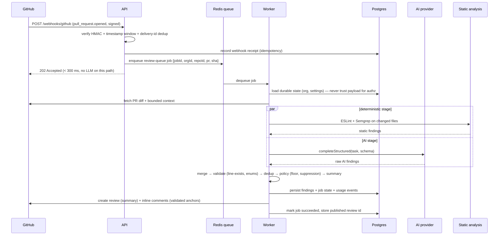
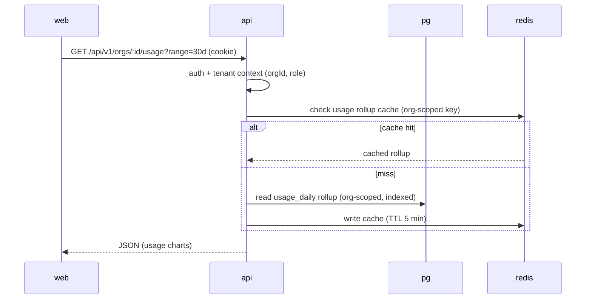

# VERCODE — System Architecture

## 1. Component Diagram

```mermaid
flowchart LR
  subgraph Browser
    UI[Next.js dashboard apps/web]
  end
  subgraph Services
    API[Fastify API apps/api]
    WORKER[BullMQ worker apps/worker]
  end
  subgraph Data
    PG[(PostgreSQL)]
    RD[(Redis: sessions, queues, diff-cache)]
  end
  subgraph External
    GH[GitHub App + REST + user OAuth]
    AI[AI providers: OpenAI / Anthropic / Ollama]
    OBS[Sentry + OTel collector]
  end
  subgraph Analysis
    ST[Static analysis: ESLint + Semgrep]
  end

  UI -->|REST + session cookie| API
  UI -->|GitHub OAuth (user connect)| GH
  GH -->|signed webhooks| API
  API -->|verify + enqueue| RD
  API --> PG
  API -->|GitHub OAuth callback (token exchange)| GH
  RD -->|review-queue| WORKER
  WORKER --> PG
  WORKER --> ST
  ST -->|deterministic findings| WORKER
  WORKER --> AI
  AI -->|structured findings| WORKER
  WORKER --> GH|publish review + comments|
  API & WORKER --> OBS
  UI --> API
```

## 2. Request-Path Diagrams

### 2.1 Webhook → Review (the hot path)



### 2.2 Dashboard read



## 3. Process Boundaries

- **`api`** — owns: auth, dashboard REST, webhook ingress (verify+enqueue), GitHub OAuth routes (user connect + callback + disconnect), config endpoints. *Never* runs the review pipeline.
- **`worker`** — owns: dequeue → fetch → analyze (static + AI) → validate → publish → account. May scale to N instances; each enforces its own concurrency limit (default 4) and org-shard awareness.
- **`web`** — stateless frontend; all data via `api`. No direct DB or GitHub access.

## 4. Data Flow

See `DATA_FLOW.md` for field-level flow (what crosses each boundary, and what must never cross it — e.g., secrets, raw diffs to AI providers beyond bounded context, client-supplied usage state).

## 5. Deployment Boundaries

Three containers, one Postgres, one Redis. `web` and `api` scale horizontally and statelessly. `worker` autoscales on queue depth. The static-analysis stage is a *sub-process of the worker* in MVP (still isolated: its own CPU/mem limits, no production credentials) and becomes a *separate sandboxed runner* in Phase 2 when untrusted code execution is enabled.
